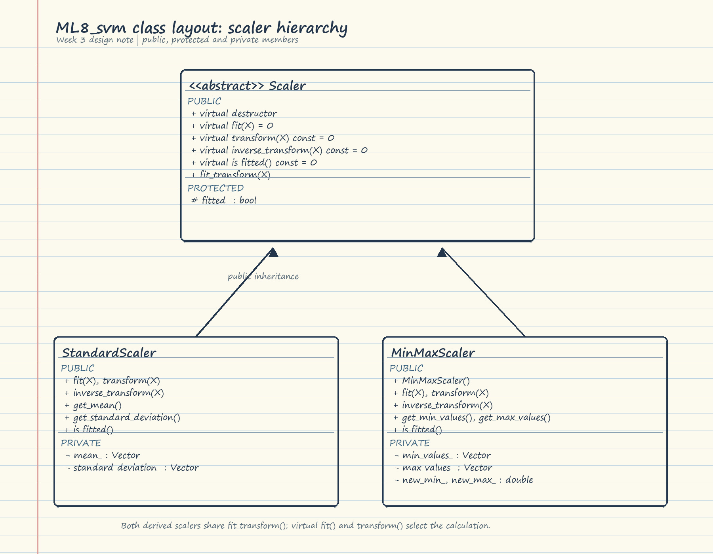
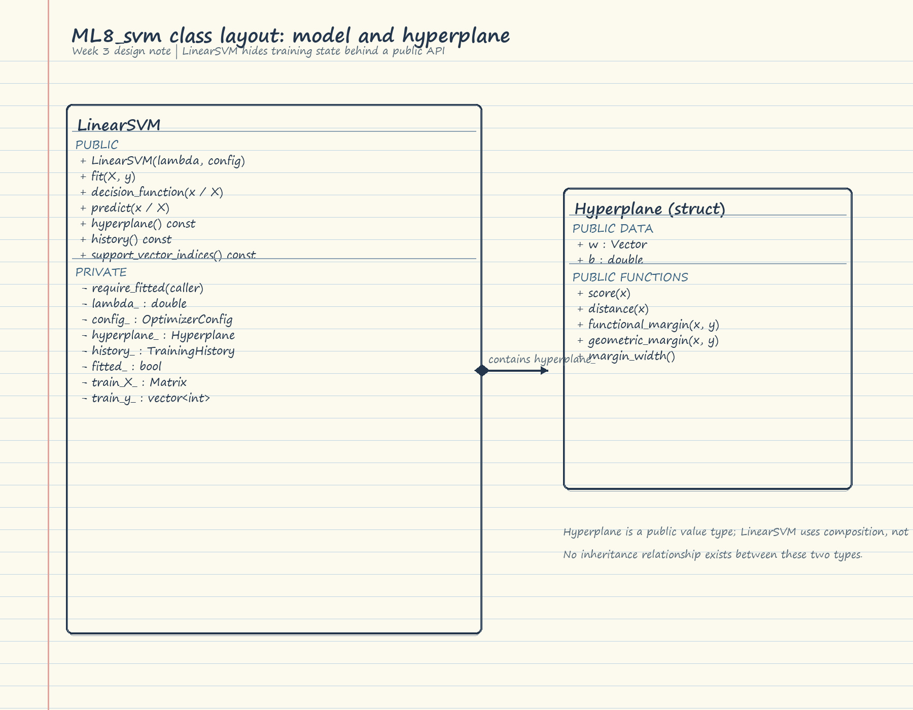

# Week 3 Progress Report: Majorine

**Project area:** Support vectors and submission documentation  

## Completed

- Wrote `examples/example7_support_vectors.cpp` to train on the real dataset and report support vectors, margin width, and test accuracy.
- Prepared the final report, README, and weekly documentation.
- Added class-layout illustrations for the scaler interface and the `LinearSVM` model.
- During final integration on 24 October, compiled and linked the library, all 13 tests, and all eight examples with Clang. All test and example programs ran successfully. CMake/CTest could not be used on this host because no supported build tool was installed; see the project final report.

## Week 3 object-oriented design notes

### Inheritance

`Scaler` is an abstract base class. It declares the scaling operations as public virtual functions and has a virtual destructor. `StandardScaler` and `MinMaxScaler` publicly inherit from `Scaler` and override `fit`, `transform`, `inverse_transform`, and `is_fitted`. The base class holds the shared fitted-state flag as a protected member so derived scalers can update it while callers cannot change it directly.

### Polymorphism

The shared interface lets client code keep a `Scaler&` and use either derived scaler through the same calls. The inherited `fit_transform` method calls the virtual `fit` and `transform` functions, so the selected derived class performs its own calculation at runtime. `tests/test_scaler.cpp` exercises this through base references, and `examples/example2_scaling.cpp` demonstrates both implementations.

### Encapsulation

`LinearSVM` exposes operations such as `fit`, `predict`, `decision_function`, `hyperplane`, `history`, and `support_vector_indices` as public methods. Its settings, fitted-state flag, learned hyperplane/history, and retained training data are private. Users ask the object to train and predict rather than modifying these internal fields directly. `Hyperplane` is a public value type used by composition; it is not a base class of `LinearSVM`.

The lined-paper-style JPGs show the public, protected, and private sections with `+`, `#`, and `-` notation:

## Next Week

- Run the documented CMake/CTest commands on a machine with a supported C++17 build tool.
- Complete the scikit-learn comparison planned in the project objectives when that dependency is available.
- Review the final package and presentation on the target submission environment.

## Challenges and Blockers

- CMake selected NMake, but NMake was unavailable. The available MinGW tools failed to start on this host. Direct Clang compilation, linking, tests, and examples succeeded.
- Scikit-learn was not installed in the available Python environment, so no comparison values are claimed.

## AI Use

This individual report records Claude (Anthropic) as support for a first draft of the support-vector example and report templates, to reduce boilerplate. The project-wide declaration also records the ChatGPT assistance used during the separate final integration pass.
